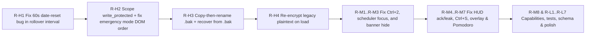

# ChronoWard v2.0.5 — Code Review Report (Post-Remediation Pass 2)

**Stage:** 06 Code Review (Pass 2) · **Date:** 2026-10-27 · **Scope:** `src/`, `src-tauri/src/`, Tauri config/capabilities, `tests/`, `.icm/_config/`
**Commits Reviewed:** `6165074` (C1), `c8b884c` (H1–H4), `af45d7b` (M1–M11), `a3e63ac` (L1–L14)
**Checks Run:** `npm test` → 10/10 pass (`tests/utils.test.js`, `tests/timers.test.js`).

## Summary

| Severity | Pass 1 Count | Pass 2 Count | Theme |
| :--- | :---: | :---: | :--- |
| 🔴 Critical | 1 | **0** | Primary decrypt-failure overwrite blocked on backend (`write_protected` + regression test) |
| 🟠 High | 4 | **4** | 1 regression (`currentDate` interval resets past dates every 60s) + 3 incomplete data-safety/migration paths |
| 🟡 Medium | 11 | **8** | Incomplete fixes in `Ctrl+2`, scheduler focus-stealing, banner hiding, HUD acks, `Ctrl+S`, overlay/Pomodoro |
| ⚪ Low | 14 | **7** | Remaining schema/comment drift, Range Viewer modal UX, falsy `0` setting, dead code/AAD |

---

## ✅ What Is Done Well

1. **Keychain-Loss Protection (`H1` — Resolved):**
   - [`lib.rs` L31-32](../../../src-tauri/src/lib.rs#L31-L32) and [`crypto.rs` L50-101](../../../src-tauri/src/crypto.rs#L50-L101) now inspect `check_encrypted_data_exists(&data_dir)` **before** probing the OS keychain. If `keyring::Error::NoEntry` is returned while `enc1:` files exist on disk, `ensure_key_exists()` refuses to generate a new key and cleanly transitions the app into read-only emergency mode.
2. **Backend Write-Protection Gate & Regression Test (`C1` Backend Core & `M1` — Well Implemented):**
   - [`state.rs` L166, L286-291](../../../src-tauri/src/state.rs#L166) adds an `AtomicBool` (`write_protected`) checked by `guard_write!`.
   - [`sheets.rs` L150-181](../../../src-tauri/src/commands/sheets.rs#L150-L181) adds a deterministic async unit test (`test_c1_decrypt_failure_blocks_writes`) verifying that a decrypt failure blocks subsequent `save_sheets` calls and preserves the original ciphertext on disk.
   - [`crypto.rs` L330-340](../../../src-tauri/src/crypto.rs#L330-L340) replaces `probe_keychain()` in `test_two_encryptions_produce_different_ciphertext` with an in-memory `SecretVec`, eliminating production OS keychain pollution during tests (`M1`).
3. **CSP Hardening & Externalized Window Scripts (`M4` Core — Well Implemented):**
   - Inline scripts were extracted from [`hud.html`](../../../src/hud.html) and [`overlay.html`](../../../src/overlay.html) into [`hud.js`](../../../src/hud.js) and [`overlay.js`](../../../src/overlay.js), and `'unsafe-inline'` was removed from `script-src` in [`tauri.conf.json` L13](../../../src-tauri/tauri.conf.json#L13).
4. **HUD Payload Sanitization & Unit Tests (`M5`, `M11` Frontend — Well Implemented):**
   - [`utils.js` L79-101](../../../src/utils.js#L79-L101) adds `validateHudPayload()`, validating `^\d{4}-\d{2}-\d{2}$` dates, clamping hours to `[0, 24]`, and constructing a fresh typed row object.
   - [`timers.js` L74-79](../../../src/timers.js#L74-L79) extracts `calculateRoundedHours()` as a pure function with unit tests in [`tests/timers.test.js`](../../../tests/timers.test.js).
5. **Durable Temp-File Fsync, CSV Formula/BOM Fixes & Hygiene (`H3` Fsync, `L4`, `L5`, `L6`, `L7`, `L10`, `L11`, `L12` — Well Implemented):**
   - [`settings.rs` L134-145](../../../src-tauri/src/commands/settings.rs#L134-L145) calls `file.sync_all().await` before renaming temp files and cleans up `.tmp` on write/sync errors.
   - [`utils.js` L16-33](../../../src/utils.js#L16-L33) fixes `escHtml(0)` via `str ?? ''`, checks raw strings for leading `\t`/`\r` formula triggers before `trimStart()`, and uses `crypto.randomUUID()` in `generateId()`.
   - [`app.js` L1213](../../../src/app.js#L1213) adds the UTF-8 BOM (`\uFEFF`) and CRLF (`\r\n`) line endings to CSV exports.
   - [`csv.rs` L51](../../../src/commands/csv.rs#L51) replaces `.expect()` with `.map_err(...)`, removes unused `import_csv`/`get_data_dir` commands (`L1`/`L4`), and [`lib.rs` L121](../../../src-tauri/src/lib.rs#L121) routes startup autostart sync through `load_settings` (`L10`).
   - [`crypto.rs` L72, L93](../../../src-tauri/src/crypto.rs#L72) wraps hex key strings in `secrecy::SecretString`.

---

## ❌ What Isn't Done Well (Regressions & Incomplete Fixes)

1. **Midnight Rollover Fix (`H2`) Introduced a High-Severity Regression (`R-H1`):**
   - [`app.js` L138-140](../../../src/app.js#L138-L140) checks `if (currentDate !== realToday)` and `if (document.getElementById('selectedDate').value === currentDate)`. Because `#selectedDate.value` is always set to `currentDate` whenever a user navigates to another date, **anyone viewing or editing a past/future timesheet is forcibly yanked back to today within 60 seconds**.
2. **Write-Protection & Emergency Mode (`C1`) Have Cross-Layer Contradictions (`R-H2`):**
   - In [`sheets.rs` L86-98](../../../src-tauri/src/commands/sheets.rs#L86-L98), when `sheets.json` fails JSON parsing, the file is **already quarantined** and `load_sheets` returns `"ok": true`, yet `write_protected` is set to `true` — so the UI starts normally and then crashes into emergency mode on the first edit.
   - In [`settings.rs` L57, L64](../../../src-tauri/src/commands/settings.rs#L57) and [`timers.rs` L45, L57](../../../src-tauri/src/commands/timers.rs#L45), a corrupt/undecryptable `settings.json` or `timers.json` sets global `write_protected = true` **without quarantining the bad file** and returns `Ok(...)`, permanently blocking `sheets.json` saves across every future restart with a misleading "keychain unavailable" message.
   - In [`app.js` L52 vs L102](../../../src/app.js#L52), `enterEmergencyMode()` runs **before** `loadSheetForDate()` creates the table rows. On `DECRYPT_FAILED`, backend `state.emergency_mode` is `None`, so `renderer-ready` never re-triggers `enterEmergencyMode()`, leaving all table inputs/buttons enabled.
3. **Backup Rotation (`H3`) Can Lose the Primary File and Never Recovers From `.bak` (`R-H3`):**
   - [`settings.rs` L147-155](../../../src-tauri/src/commands/settings.rs#L147-L155) moves `path` to `.json.bak` via `rename` *before* renaming `.tmp` to `path`. If the second rename fails or power is lost in between, `sheets.json` is missing on disk. Furthermore, **nothing in `sheets.rs`, `settings.rs`, or `timers.rs` ever reads `.json.bak`** on missing file or decrypt failure.
4. **Legacy Plaintext Migration (`has_legacy_plaintext`) Bricks the App on Second Launch (`R-H4`):**
   - [`sheets.rs` L62-64](../../../src-tauri/src/commands/sheets.rs#L62-L64) and [`settings.rs` L50-52](../../../src-tauri/src/commands/settings.rs#L50-L52) set `has_legacy_plaintext = true` when reading plaintext data on `is_new_key = true`, but nothing ever reads that flag or re-encrypts the file on load. Any file not manually saved during the first session is rejected as a downgrade attack on the next launch (`is_new_key = false`), locking the app into `write_protected = true`.
5. **Several Medium/Low Fixes Stopped Halfway (`R-M1` to `R-M7`):**
   - **`H4` (`Ctrl+2`):** [`app.js` L1590](../../../src/app.js#L1590) still has `const views = ['timesheet', 'import', 'settings']`, so `Ctrl+2` hits the new `switchView` guard and does nothing.
   - **`M2` (Focus Stealing):** [`lib.rs` L137](../../../src-tauri/src/lib.rs#L137) was fixed, but [`scheduler.rs` L123-129](../../../src-tauri/src/scheduler.rs#L123-L129) still calls `window.set_focus()` every minute while `warning_active` is true.
   - **`M3` (Warning Banner Stuck):** [`app.js` L250](../../../src/app.js#L250) guards `if (currentDate === getTodayString()) checkHoursWarning()`, and `loadSheetForDate()` never calls `checkHoursWarning()`, so the new `hideBanner()` early return in `checkHoursWarning()` is never reached when switching dates.
   - **`M7`/`M9` (HUD Ack & Save Queue):** `saveCurrentSheet()` swallows errors and returns early when `isSaving` or `isEmergencyMode` is true, so [`app.js` L281-285](../../../src/app.js#L281-L285) still emits `hud-entry-saved` ("Logged!") when saving fails or is blocked. [`hud.js` L64-85](../../../src/hud.js#L64-L85) also leaks IPC listeners on timeout.
   - **`M8` (`Ctrl+S`):** [`app.js` L1614-1615](../../../src/app.js#L1614-L1615) still does not `await saveCurrentSheet()` and shows `"Timesheet saved to disk"` even in read-only emergency mode.
   - **`L9` (Overlay Position):** [`window.rs` L71-95](../../../src-tauri/src/commands/window.rs#L71-L95) ignores `monitor.position()` (multi-monitor offset) and `monitor.work_area()` (taskbar overlap).

---

## 🟠 High

### R-H1. Midnight rollover check triggers every 60 seconds on any non-today date and yanks the user back to today
**Where:** [`app.js` L135-157](../../../src/app.js#L135-L157)

**Trace:**
1. The user selects a previous date (e.g. yesterday) via `#selectedDate` ([L114](../../../src/app.js#L114)), `Alt+←` ([L1522](../../../src/app.js#L1522)), or the Range Viewer's "Edit Date" button ([L1421](../../../src/app.js#L1421)). Both `currentDate` and `document.getElementById('selectedDate').value` become that date.
2. Within 60 seconds, the rollover interval runs:
   - `currentDate !== realToday` is `true`.
   - `document.getElementById('selectedDate').value === currentDate` is **always `true`**.
3. The interval saves, overwrites `currentDate = realToday`, sets `#selectedDate.value` to today, and calls `loadSheetForDate(realToday)` — wiping the table while the user is viewing or editing a past date.

**Fix:**
Track the calendar day at startup (`let lastKnownToday = getTodayString();`) and only run rollover logic when `realToday !== lastKnownToday`:
```javascript
let lastKnownToday = getTodayString();
setInterval(() => {
  const realToday = getTodayString();
  if (realToday !== lastKnownToday) {
    const wasViewingToday = (currentDate === lastKnownToday);
    lastKnownToday = realToday;
    if (wasViewingToday && !store.isEmergencyMode) {
      saveCurrentSheet();
      currentDate = realToday;
      document.getElementById('selectedDate').value = currentDate;
      loadSheetForDate(currentDate);
      renderWeeklyCompletion();
      // recalculate theme...
    }
  }
}, 60000);
```

### R-H2. `write_protected` & `enterEmergencyMode` ordering flaws lock out valid sheets and leave inputs enabled on `DECRYPT_FAILED`
**Where:** [`sheets.rs` L67-100](../../../src-tauri/src/commands/sheets.rs#L67-L100), [`settings.rs` L55-66](../../../src-tauri/src/commands/settings.rs#L55-L66), [`timers.rs` L43-60](../../../src-tauri/src/commands/timers.rs#L43-L60), [`state.rs` L220-222](../../../src-tauri/src/state.rs#L220-L222), [`app.js` L51-103, L166-193](../../../src/app.js#L51-L103)

**Trace:**
1. **Quarantined JSON contradiction (`sheets.rs` L86-98):** When `sheets.json` fails JSON parsing, it is already renamed to `sheets.json.corrupt.<ts>` and returns `"ok": true, "warning": "CORRUPT_DATA_QUARANTINED"`. Setting `state.write_protected = true` on L86 causes the first user edit to fail with `WRITE_BLOCKED_EMERGENCY_MODE` and trigger a false "keychain unavailable" banner.
2. **Cross-file lockout (`timers.rs` L45/57, `settings.rs` L57/64):** If `timers.json` or `settings.json` is corrupt, `load_timers` / `load_settings` sets the global `write_protected = true` without quarantining the file and returns `Ok(...)`. `load_sheets` succeeds (`ok: true`), the UI opens normally with no warning, and then every save fails across this and all future launches.
3. **DOM ordering (`app.js` L52 vs L102):** On `DECRYPT_FAILED`, `enterEmergencyMode(sheetsResult)` runs at L52 while `#timesheetBody` is still empty. `loadSheetForDate(currentDate)` runs at L102 and creates enabled row inputs and buttons. Because backend `state.emergency_mode` is `None` on `DECRYPT_FAILED`, `renderer-ready` (L125) never re-emits `emergency-mode`, leaving all row inputs editable in the UI.

**Fix:**
- Only set `write_protected = true` when `sheets.json` fails decryption (or if quarantining a corrupt file fails). When `timers.json` or `settings.json` fails decryption/parsing, quarantine it to `*.corrupt.<ts>` so it does not poison `sheets.json` saves.
- Update `AppState::is_read_only()` in `state.rs` L220 to `self.emergency_mode.is_some() || self.write_protected.load(Ordering::SeqCst)`.
- In `app.js`, apply the read-only disabled state *after* `loadSheetForDate()` (or inside `addRow()` when `store.isEmergencyMode` is true) and disable `.ticket-input, .desc-btn, .row-menu-btn, .row-checkbox, #selectAllCheck, #selectedDate, #cleanSlateBtn`.

### R-H3. `atomic_write` two-step rename creates a file-loss window and `.json.bak` is never read for recovery
**Where:** [`settings.rs` L147-155](../../../src-tauri/src/commands/settings.rs#L147-L155), [`sheets.rs` L50-76](../../../src-tauri/src/commands/sheets.rs#L50-L76)

**Trace:**
1. `atomic_write` renames `path` (`sheets.json`) to `sheets.json.bak` (L149) **before** renaming `tmp_path` to `path` (L152). If the second rename fails (e.g. transient Windows file lock) or power fails between the two renames, `sheets.json` no longer exists on disk and `tmp_path` is deleted (L153).
2. Neither `load_sheets`, `load_settings`, nor `load_timers` ever checks for or falls back to `.json.bak`. On next launch, `load_sheets` sees `!path.exists()` (L50), returns `{ ok: true, data: {} }`, and subsequent saves overwrite both `sheets.json` and `sheets.json.bak` with empty data.

**Fix:**
- Copy `path` to `bak_path` (`tokio::fs::copy(path, &bak_path).await`) before `tokio::fs::rename(&tmp_path, path).await` so `path` is atomically replaced in a single step and is never absent on disk.
- In `load_sheets_impl`, if `sheets.json` is missing or fails decryption while `sheets.json.bak` exists and decrypts cleanly, restore from `sheets.json.bak` and surface a recovery warning.

### R-H4. Legacy plaintext files are not re-encrypted on load, triggering a downgrade block on the next launch
**Where:** [`sheets.rs` L60-66](../../../src-tauri/src/commands/sheets.rs#L60-L66), [`settings.rs` L48-54](../../../src-tauri/src/commands/settings.rs#L48-L54), [`timers.rs` L41-42](../../../src-tauri/src/commands/timers.rs#L41-L42), [`state.rs` L152](../../../src-tauri/src/state.rs#L152)

**Trace:**
1. On first run (`is_new_key = true`), `state.decrypt()` allows legacy plaintext files and returns `DecryptResult::WasPlaintext`.
2. `sheets.rs` and `settings.rs` set `*state.has_legacy_plaintext = true`, which is **never read anywhere in the codebase**, and `timers.rs` ignores `needs_reencrypt()` completely.
3. If the user closes the app without triggering a save on all three files (e.g. no timer is started so `timers.json` isn't saved), on the second run `is_new_key` is `false`. `state.decrypt()` rejects the unmigrated plaintext file as an `"Insecure downgrade attack"`, sets `write_protected = true`, and blocks all writes.

**Fix:**
When `result.needs_reencrypt()` is true in `load_sheets_impl`, `load_timers`, or `load_settings` and `state.keychain_available()` is true, immediately encrypt and `atomic_write` the file during load. Remove the dead `has_legacy_plaintext` mutex from `AppState`.

---

## 🟡 Medium

| ID | Finding | Where | Recommended fix |
| :--- | :--- | :--- | :--- |
| R-M1 | **`Ctrl+2` still passes `'import'` and does nothing (`H4` incomplete).** `switchView()` now guards against invalid IDs, and `index.html` was updated, but the `keydown` handler still has `const views = ['timesheet', 'import', 'settings']`. Pressing `Ctrl+2` calls `switchView('import')` and returns early instead of opening `'timesheets-view'`. | [`app.js` L1588-1593](../../../src/app.js#L1588-L1593) | Change line 1590 to `const views = ['timesheet', 'timesheets-view', 'settings'];`. |
| R-M2 | **`scheduler.rs` still steals window focus every minute (`M2` incomplete).** While `lib.rs` L137 was updated to `request_user_attention`, `scheduler.rs` still checks `if warning_active` every minute after `warning_time` and calls `window.show()`, `window.unminimize()`, and `window.set_focus()`. | [`scheduler.rs` L118-130](../../../src-tauri/src/scheduler.rs#L118-L130) | Remove the `if warning_active { ... window.set_focus(); }` block in `scheduler.rs` L123-129; let `check-hours-warning` and the one-shot `warning-active` event in `lib.rs` handle attention requests. |
| R-M3 | **Hours warning banner still stays visible when leaving today (`M3` incomplete).** `hideBanner()` was added inside `checkHoursWarning()` when `currentDate !== getTodayString()`, but `loadSheetForDate()` never calls `checkHoursWarning()`, and the `check-hours-warning` listener at L250 guards `if (currentDate === getTodayString()) checkHoursWarning()`, making the `hideBanner()` early return unreachable on date navigation. | [`app.js` L249-251, L584-592, L1459-1463](../../../src/app.js#L249-L251) | Call `checkHoursWarning()` inside `loadSheetForDate()`, and remove the `if (currentDate === getTodayString())` guard on line 250. |
| R-M4 | **HUD ack race, leaked listeners, and false-positive `"Logged!"` on save error (`M7`/`M9` incomplete).** `saveCurrentSheet()` catches errors internally and returns `undefined` early when `isSaving` or `store.isEmergencyMode` is true, so `saveCurrentSheet().then(() => emit('hud-entry-saved'))` at L281-285 reports success even when saving failed or is blocked. In `hud.js`, `listen()` Promises are not awaited before `emit('hud-entry-added')`, the 5s timeout rejects without calling `cleanup()` (leaking both listeners), and `commitLog()` does not block `.ticket-invalid` inputs. | [`hud.js` L13-20, L60-86, L120-125](../../../src/hud.js#L60-L86), [`app.js` L278-286, L597-622](../../../src/app.js#L278-L286) | Have `saveCurrentSheet()` return a boolean (or reject on failure) and chain queued saves so callers await the real disk write. In `hud.js`, `await Promise.all([listen(...), listen(...)])` before `emit()`, call `cleanup()` on timeout, and reject invalid ticket numbers in `commitLog()`. |
| R-M5 | **`Ctrl+S` toasts success in read-only mode / before save completes, and `saveSettings` lacks `try/catch` (`M8` incomplete).** `Ctrl+S` calls `saveCurrentSheet()` without `await` and unconditionally shows `'Timesheet saved to disk'` (even in emergency mode). `saveSettings()` awaits `invoke('save_settings')` without a `try/catch`, dropping errors as unhandled rejections. | [`app.js` L450-481, L1611-1617](../../../src/app.js#L1611-L1617) | `await saveCurrentSheet()` in `Ctrl+S` and only toast success when it returns `true`. Wrap `invoke('save_settings')` in `saveSettings()` in `try/catch` and show an error toast on failure. |
| R-M6 | **Overlay multi-monitor/taskbar positioning and Pomodoro state desync (`L9`/`L13` follow-up).** `window.rs` uses `overlay.current_monitor()` `size()` without adding `monitor.position()` (moving the overlay back to primary monitor coordinates on secondary displays) and without `monitor.work_area()` (placing bottom corners behind the taskbar). In `app.js`, `cleanSlateToggleTimer()` creates a new row and starts a timer without calling `saveCurrentSheet()`, and `cleanSlateLogFocus()` adds a new row without calling `onDataChange()` (leaving footer totals and weekly chips stale). | [`window.rs` L71-96](../../../src-tauri/src/commands/window.rs#L71-L96), [`app.js` L1105-1120, L1137-1145](../../../src/app.js#L1105-L1145) | Use `monitor.work_area()` (`position` + `size`) in `window.rs`. Call `saveCurrentSheet()` and `onDataChange()` in both `cleanSlateToggleTimer()` and `cleanSlateLogFocus()`. |
| R-M7 | **Blank rows with active timers are dropped on save, and hours upper bound (`24`) is not enforced in steppers/timers (`M6`/`L14` follow-up).** `collectRows()` skips any row with `hours === 0` and empty text even if `timers[tr.dataset.timerId]` is running or paused, orphaning the timer on date change or reload. `stepHours()` and `stopTimer()` do not clamp to `<= 24`, causing `updateTotals()` to show values `> 24` while `collectRows()` silently clamps to `24` on disk. | [`app.js` L634-637, L853-865](../../../src/app.js#L634-L637), [`timers.js` L96-99](../../../src/timers.js#L96-L99) | Preserve rows in `collectRows()` when `timers[tr.dataset.timerId]` exists. Clamp `.hours-input` to `[0, 24]` in `stepHours()`, `stopTimer()`, and on input `blur`. |
| R-M8 | **Per-window command ACLs and backend test automation (`M4`/`M11` incomplete).** `capabilities/hud.json` and `overlay.json` still allow all custom commands across all windows. `scripts/run_tests.ps1` still only runs `npm test`, and `test_c1_decrypt_failure_blocks_writes` leaves its temp directory behind in `std::env::temp_dir()`. | [`hud.json`](../../../src-tauri/capabilities/hud.json), [`overlay.json`](../../../src-tauri/capabilities/overlay.json), [`run_tests.ps1`](../../scripts/run_tests.ps1), [`sheets.rs` L150-181](../../../src-tauri/src/commands/sheets.rs#L150-L181) | Restrict per-window command permissions in capabilities, add `cargo test` to `run_tests.ps1`, and clean up `temp_dir` at the end of `test_c1_decrypt_failure_blocks_writes`. |

---

## ⚪ Low

| ID | Finding | Where |
| :--- | :--- | :--- |
| R-L1 | **Remaining schema and comment drift (`L3` incomplete).** `data_schema.json` L58 uses `"auto_start"` (snake_case) instead of `"autoStart"` (`#[serde(rename_all = "camelCase")]`), omits `projectMode`, `detailedMode`, and `focusTimes`, and retains nonexistent `themeSetAt`. `settings.rs` L3-11 and L92-95 still state settings are unencrypted by default and saved as plaintext on keychain failure. `csv.rs` L1 still lists removed `import_csv, get_data_dir`. `architecture_spec.md` L69-70 and `security_policy.md` L26 still list old command names and `.tmp.<random>`. | [`data_schema.json` L43-60](../../_config/data_schema.json#L43-L60), [`settings.rs` L1-14, L92-95](../../../src-tauri/src/commands/settings.rs#L1-L14), [`csv.rs` L1](../../../src-tauri/src/commands/csv.rs#L1) |
| R-L2 | **Range Viewer description modal discards edits silently & inverted date range UX.** Clicking `📝` in the Range Viewer opens `#descModal` with an editable `<textarea>` while setting `activeDescTimerId = null`; any text the user edits is silently discarded by `saveDescModal()`. Also, selecting `fromDate > toDate` displays `"No timesheets logged..."` instead of an invalid-range message. | [`app.js` L1286-1298, L1429-1436](../../../src/app.js#L1429-L1436) |
| R-L3 | **Theme grid highlights `settings.theme` instead of the active auto-rotated theme.** When `autoRotateTheme` is enabled, `applyTheme(activeTheme, false)` updates `document.body.className`, but `renderThemeGrid()` marks `settings.theme === theme.id` as `.active`, highlighting the base theme rather than the rotated theme currently in use. | [`app.js` L81-90, L404-433](../../../src/app.js#L404-L433) |
| R-L4 | **`minHoursWarning = 0` is overwritten by `7.5` due to falsy `||`.** `#settingMinHours` has `min="0"`, but `applySettingsToUI()`, `saveSettings()`, `renderWeeklyCompletion()`, and `checkHoursWarning()` use `settings.minHoursWarning || 7.5`, which turns `0` into `7.5`. | [`app.js` L325, L438, L455, L1470](../../../src/app.js#L438-L455) |
| R-L5 | **Remaining split state, dead code, and `Math.random` in HUD (`L1`/`L2`/`L7` incomplete).** `app.js` L11-18 still keeps module-level state variables (`sheets`, `currentDate`, `projectMode`, `detailedMode`, `isCleanSlateMode` are never written to `store`). `app.js` L893 still emits `hours-updated` with no listener. `hud.js` L51 still uses `Math.random().toString(36).substr(2, 4)` instead of `crypto.randomUUID()`. `Cargo.toml` L54 includes unused `thiserror`. | [`app.js` L11-18, L893](../../../src/app.js#L11-L18), [`hud.js` L51](../../../src/hud.js#L51), [`Cargo.toml` L54](../../../src-tauri/Cargo.toml#L54) |
| R-L6 | **Blocking dialog on async worker & silent shortcut registration failure (`L4`/`L8` partial).** `csv.rs` L47 calls `blocking_save_file()` directly inside an `async fn` command without `spawn_blocking`. `lib.rs` L92-94 logs `warn!` when `Ctrl+Shift+Space` fails to register without notifying the user in the UI. | [`csv.rs` L47](../../../src-tauri/src/commands/csv.rs#L47), [`lib.rs` L92-94](../../../src-tauri/src/lib.rs#L92-L94) |
| R-L7 | **No AAD binding filename to AES-256-GCM ciphertext (`L11` partial).** `crypto::encrypt` and `crypto::decrypt` do not bind the target filename (`sheets.json`, `timers.json`, `settings.json`) as Associated Authenticated Data, allowing encrypted files to be swapped on disk undetected. | [`crypto.rs` L120-144, L213-240](../../../src-tauri/src/crypto.rs#L120-L144) |

---

## Recommended remediation order



> [!IMPORTANT]
> **R-H1** (60-second reset when viewing any past date) and **R-H2 / R-H3 / R-H4** (false-positive lockouts and unrecovered `.bak` files) directly affect daily usability and data safety. Recommend resolving `R-H1` through `R-H4` and `R-M1` through `R-M7` before signing off Stage 05 (v2.0.5 release).

## Review gate
- [ ] Human triage: accept / defer / reject each Pass 2 finding
- [ ] Accepted High/Medium items sent back to Stage 03 as rework
- [ ] Regression tests for `R-H1`–`R-H4` added in Stage 04 (`run_tests.ps1` updated to run both frontend and backend suites)
- [ ] `data_schema.json`, `architecture_spec.md`, and `security_policy.md` (Layer 3) aligned with implementation (`R-L1`)
